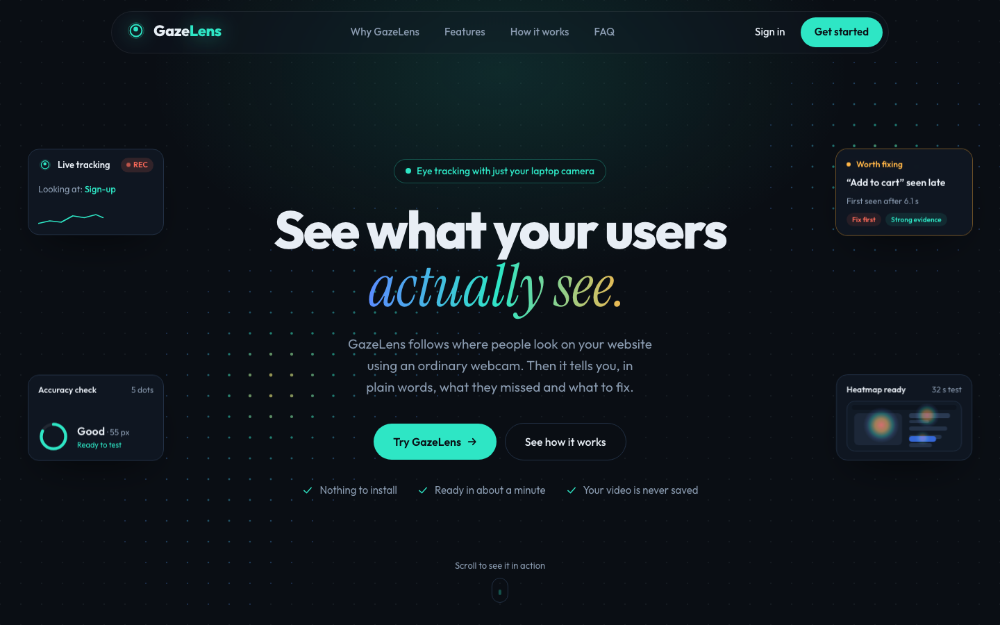
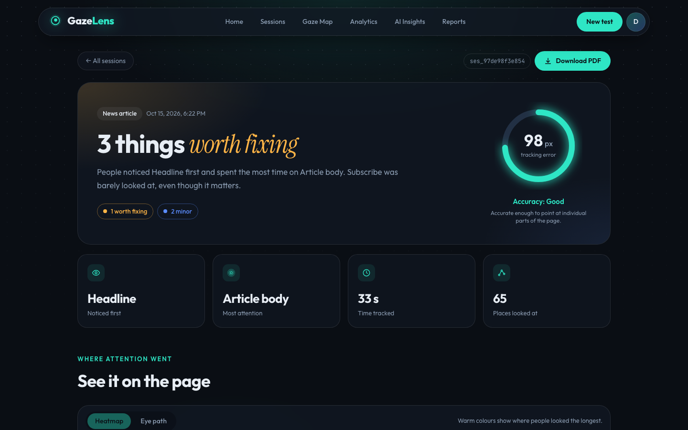
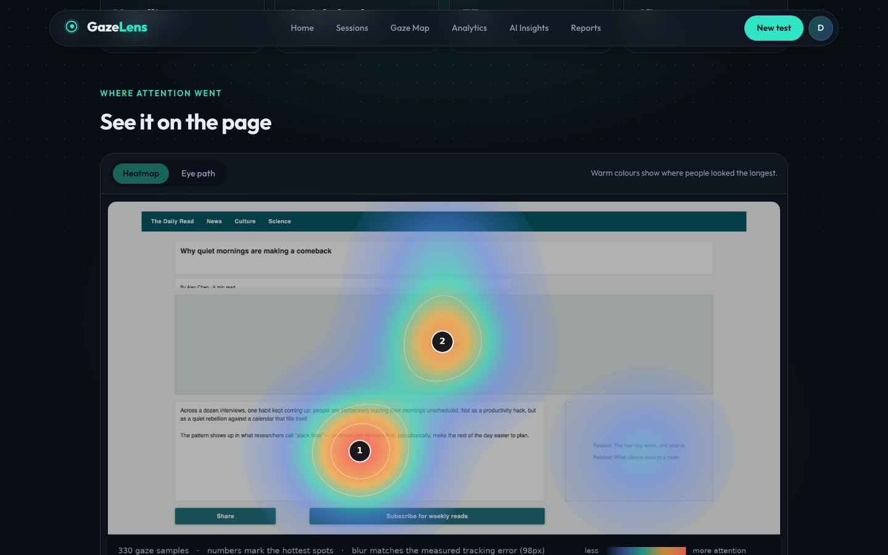
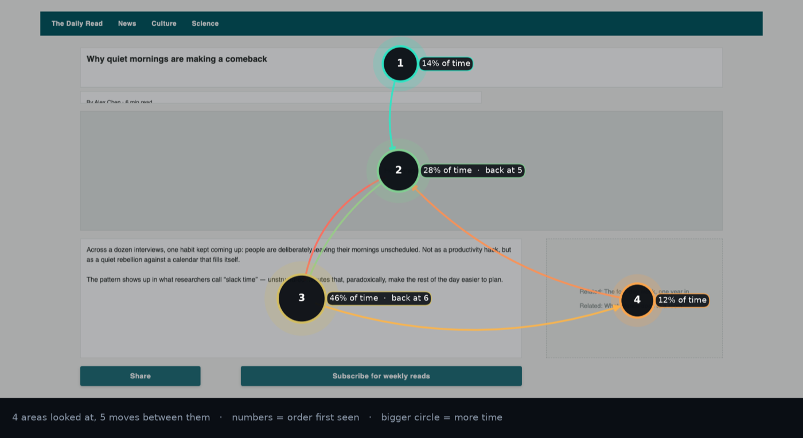
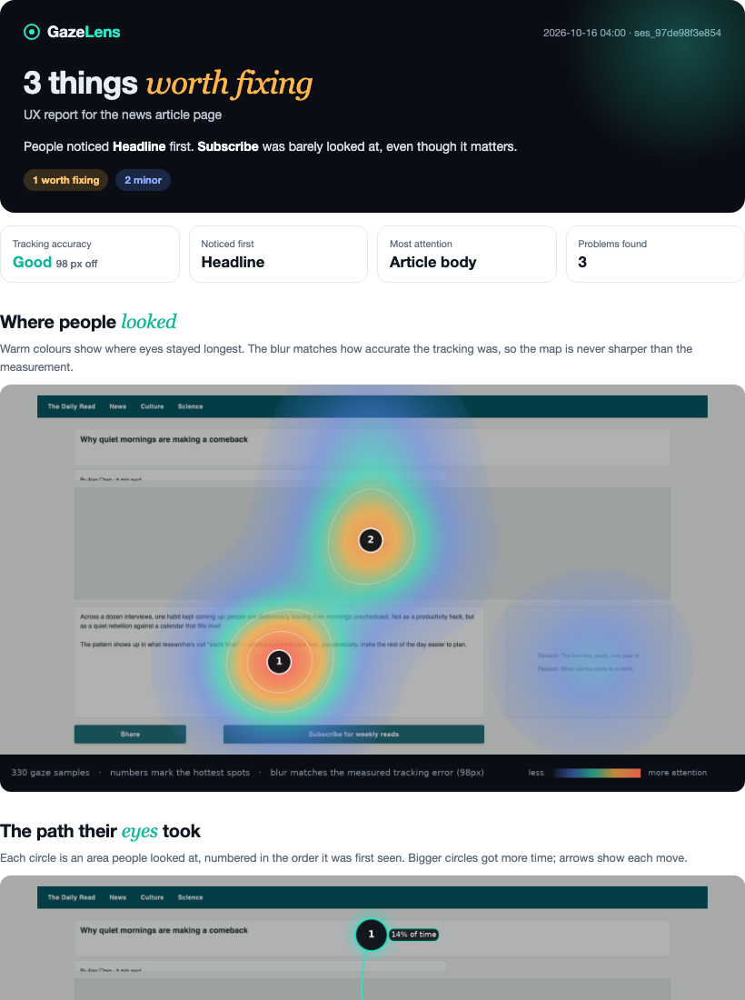
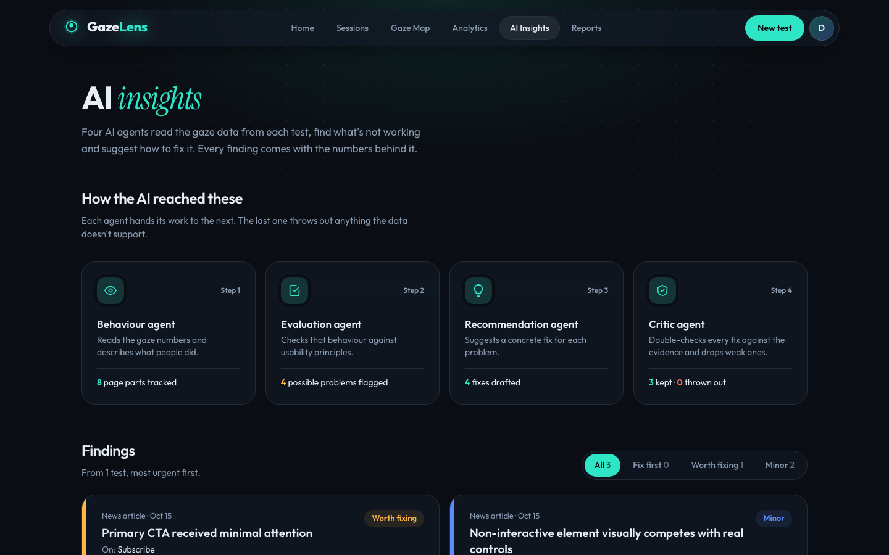
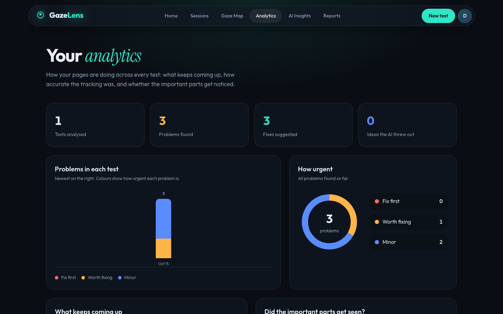
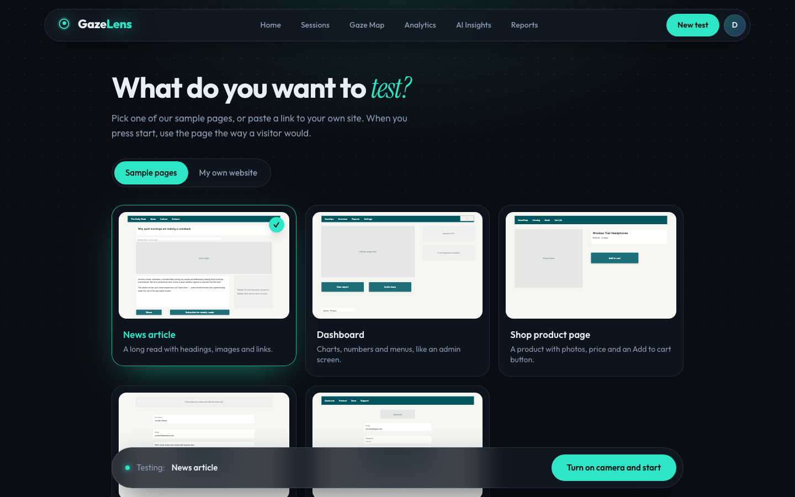
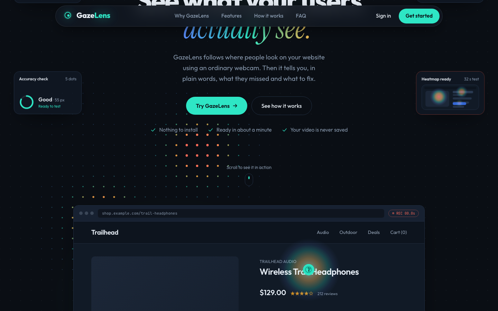
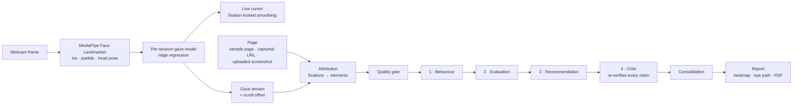

<div align="center">

# 👁️ GazeLens

**See what your users actually see.**

Webcam eye tracking and AI-agent UX reports, no special hardware needed.
Built on **GazeUX-Agent**, a multi-agent framework for gaze-driven UI/UX evaluation.


[](https://github.com/goyalnishtha841/gazelens/actions/workflows/ci.yml)
-8A63D2)



</div>

---

## Contents

- [What GazeLens does](#what-gazelens-does)
- [Project status](#project-status)
- [Screenshots](#screenshots)
- [How it works](#how-it-works)
- [Measured results](#measured-results)
- [Tech stack](#tech-stack)
- [Repository layout](#repository-layout)
- [Getting started](#getting-started)
- [Configuration](#configuration)
- [Using GazeLens](#using-gazelens)
- [API overview](#api-overview)
- [Testing](#testing)
- [Developer tools](#developer-tools)
- [Limitations](#limitations)
- [Roadmap](#roadmap)
- [Team and contributing](#team-and-contributing)

---

## What GazeLens does

Lab eye trackers are expensive, and even with gaze data someone still has to work
out *why* a design failed. GazeLens does both jobs with an ordinary laptop webcam:

1. **Sign in** with email and a strong password, or with Google.
2. **Calibrate in about a minute.** The camera turns on only after the user agrees.
   They follow 16 dots, then a 5-dot precision check measures how far off the
   tracking is. A setup that isn't precise enough is refused rather than trusted.
3. **Test any page.** Pick one of five built-in sample pages, paste a link to any
   website, or upload a screenshot or design mock-up. GazeLens finds the buttons,
   links, fields, images and text automatically.
4. **Use it normally.** Before the test starts, GazeLens checks the user is still
   sitting where they calibrated. A live gaze cursor then follows their eyes. Long
   pages scroll, and the scroll position is recorded with every frame.
5. **Get a report.** Gaze is matched to page elements, then four agents analyse it.
   The report has a verdict, a heatmap, an eye path, per-element charts, what to fix
   and how, and a downloadable PDF.

Every finding cites a measured number (for example *"Received only 0.0% of total gaze
time (threshold: 5.0%)"*). A dedicated critic agent re-derives each claim from the raw
metrics and throws out anything it can't confirm.

### Key features

| | |
|---|---|
| 🎯 **Webcam gaze tracking** | MediaPipe iris + eyelid + head-pose features, per-session ridge model, 16-point calibration and a 5-dot precision check |
| 🧭 **Steady live cursor** | Fixation-locked smoothing holds still while the eyes rest and follows real eye movements within ~0.3 s |
| 🌐 **Any website** | Playwright captures the full page and detects elements; gaze is mapped through scrolling to the whole document |
| 🖼️ **Screenshots and mock-ups** | Upload an image; OCR (RapidOCR) reads its text and OpenCV finds its shapes, so buttons, fields, menus, images and text are boxed and named automatically for the tester to check. Found 30 of 32 hand-labelled elements (94%) on the five sample pages |
| 📊 **Per-element metrics** | Dwell time, time to first look, fixation count, revisits and scanpath for every element |
| 🤖 **Four-agent analysis** | Behaviour → Evaluation → Recommendation → Critic, with optional LLM writing (Groq or Claude) that the critic must verify |
| 🛡️ **Honest by design** | A quality gate blocks findings when tracking is unreliable, and elements smaller than the measured error are flagged as indicative |
| 🔥 **Report visuals** | Heatmap over the real page (blur = measured error), an eye path built from real fixations, attention bars and a first-look timeline |
| 📄 **PDF reports** | Branded, print-ready PDF with the verdict, visuals, problems, fixes and a "how we checked" audit |
| 📈 **Analytics across tests** | Problems per test, urgency breakdown, recurring design principles, key-element coverage and eye-tracking precision trend |
| 🔐 **Accounts and security** | Sign-up with a required name and a strong password (checked live and by the API), bcrypt + JWT, login required on every API route, failed-login rate limiting; sessions, reports, calibrations and gaze models are visible only to their owner |
| 🔑 **Sign in with Google** | One button signs in or creates an account; Google's ID token is verified server-side with Google's own library (signature, audience, issuer, expiry, verified email) |
| 📷 **Camera consent** | GazeLens asks in its own dialog, explaining what is sent and stored, before the browser's camera prompt; nothing touches the camera until the user agrees |
| 🪑 **Position check** | Before each test, about a second of frames is compared with the head pose from calibration; a user who has turned, leaned in or sat back is asked to recalibrate |
| ♻️ **Crash-safe analysis** | A report interrupted by a crash or restart is marked failed with a clear message and can be retried, instead of spinning forever |

---

## Project status

*As of October 2026.*

| Area | State |
|---|---|
| End-to-end app (calibrate → test → report → PDF) | ✅ Works locally (API + web app on one machine) |
| Eye-tracking precision | ✅ ~65 px median on held-out dots, **measured on one participant**; multi-participant pilot not yet run |
| Tests and CI | ✅ 938 backend tests in 10 suites and an end-to-end check over real HTTP; ruff, frontend build and API image build run on every push and PR (GitHub Actions) |
| Security | ✅ Login on every route (password or Google), strong-password rules, owner-scoped data, login rate limiting, private-address blocking for URL capture (including redirects), camera consent |
| What can be tested | ✅ Five sample pages, any live website, and uploaded screenshots or mock-ups with automatic element detection |
| Agents | ✅ Rule-based findings with optional LLM wording that the critic re-verifies. A fixed four-step chain, not yet tool-using or iterative |
| Hosting | ⏳ Deploy config is ready (API image, Vercel config, [DEPLOY.md](DEPLOY.md)) but nothing is hosted: the API needs ~2 GB RAM, which free tiers don't offer |
| Product features | ⏳ One person tests at a time; no studies, shareable participant links or aggregated results yet |

What's next is in the [Roadmap](#roadmap); research items with exact steps are in
[OPEN_ITEMS.md](OPEN_ITEMS.md).

---

## Screenshots

| Session report | Heatmap over the real page |
|---|---|
|  |  |
| **Eye path (real fixations, grouped into areas)** | **Downloadable PDF report** |
|  |  |
| **AI insights: the four agents and their findings** | **Analytics across every test** |
|  |  |
| **Choosing what to test** | **Landing page: who it's for** |
|  |  |

---

## How it works



**1. Calibration** (`backend/calibration`, `backend/gaze_estimation`).
The user looks at 16 dots in random order, about 24 frames each. Several feature sets
are compared: iris position relative to the eye corners, eyelid openness, MediaPipe
`eyeLook*` blendshapes and head pose. Model degree and ridge strength are chosen by
leave-one-point-out cross-validation. Degree-1 models are fitted on one median row
per dot, which removes the frame noise that otherwise squashes gaze towards the
screen's centre. A 5-dot precision check then measures the error on *new* points.
A per-axis bias correction is kept only if it beats the raw model by 10% on held-out
dots, and calibrations over 15% of the screen diagonal are refused.

**2. Live session** (`backend/api`, `frontend-new/src/views/LiveSession.jsx`).
The camera starts only after the user agrees in GazeLens's own consent dialog
(`components/CameraConsent.jsx`). A one-second position check then compares the
head pose with the one saved at calibration (more than 8° of turn or tilt, or 15%
closer or farther, asks for a recalibration;
`POST /api/gaze/models/{id}/position-check`). Each webcam frame goes to the server, which returns a gaze point remapped into the
page area. The cursor uses a fixation-locked stabiliser
(`frontend-new/src/lib/gazeStabilizer.js`). The server stores the raw stream, because
fixation detection needs real saccade timing.

**3. Any URL** (`backend/render`).
Playwright captures a full-page screenshot and detects interactive and content
elements with heuristic classification. Every capture reports how much was guessed.
Gaze points carry the page's scroll offset and are translated into document
coordinates, so long pages work.

**3b. Uploaded screenshots** (`backend/api/uploads.py`, `backend/render/image_detect.py`).
An image has no DOM, so elements are found from pixels. RapidOCR (an ONNX text
reader on the CPU) reads every line of text; OpenCV finds solid shapes (buttons,
photos) and outlined ones (input fields). Each box is then classified by what is
inside it: a solid shape with a short label is a button, a light box with a small
label or grey placeholder is a field, a row of short words at the top is the menu,
a large area with little text is an image, and the rest is text named from its
first line. The tester sees these as editable suggestions, each with the reason it
was proposed, before the test starts. The image is re-encoded as PNG and stored in
the same shape as a website capture, so attribution, agents and reports need no
changes.

**4. Attribution** (`backend/attribution`).
Dispersion-based fixation detection, then hit-testing against element boxes with a
near-miss tolerance tied to the measured tracking error. This produces dwell time,
time to first fixation, fixation and revisit counts, and the scanpath.

**5. Agents** (`backend/agents`).

| Agent | Role | With an LLM key |
|---|---|---|
| Quality gate | Blocks findings when gaze error, tracking coverage or data volume is too poor ("insufficient"), or caps severity ("limited") | unchanged |
| 1 · Behaviour | First noticed, most attended, ignored important elements, scattered attention | also writes a plain-English account of the session |
| 2 · Evaluation | Maps behaviour to usability heuristics with a severity | also explains each issue for this specific page |
| 3 · Recommendation | Template fixes per issue | writes one specific fix per issue, naming the element |
| 4 · Critic | Re-derives every cited metric and every number in the text; rejects what it can't confirm | **always deterministic, never calls an LLM** |
| Consolidation | One issue and one fix per element, readable names, caveats on elements smaller than the gaze error | unchanged |

**6. Reports** (`backend/reports`).
The heatmap is gaze density over the page screenshot, blurred by the measured error
and with the hottest spots numbered. The eye path groups real fixations into areas,
sized by time and numbered by first visit. The HTML report renders to PDF through
WeasyPrint (run in a separate process, so a native-library crash can't take the API
down), or headless Chromium as a fallback.

---

## Measured results

All numbers below are reproducible from data and scripts in this repository.

### Eye-tracking precision (webcam, held-out precision-check dots)

*Eye-tracking precision* is how far, on average, GazeLens's estimate of where someone
looked is from where they really looked, in screen pixels (lower is better). It
describes the eye tracking, not how correct a report is. The app shows it as
"Eye-tracking precision: Good · 52 px off".

Measured with `scripts/evaluate_gaze_sessions.py`, which retrains each saved
calibration and scores it on that sitting's 5 precision-check dots. These dots are
never used for training.

| Model | Median error | p90 error | Vertical gain* |
|---|---|---|---|
| Fitted on every frame (previous) | 76 px | 137 px | 0.65 |
| **Fitted on per-dot medians (current)** | **65 px** | **120 px** | **0.83** |

\*Gain is the slope of predicted vs. true position; 1.0 means the full screen range
is reproduced. Basis: 4 calibrations, 20 check dots, one participant, on a
1694×840 laptop screen. A multi-participant study is still to come (see
[Limitations](#limitations)).

### Live cursor stability

Replaying recorded precision-check frames through each smoothing method:

| Method | Average movement while holding still | Worst 5% | Frames to follow a real move |
|---|---|---|---|
| Raw | 118 px | 260 px | 0 |
| One-Euro filter (previous) | 44 px | 97 px | 2 |
| **Fixation-locked stabiliser (current)** | **14 px** | **38 px** | **3 (~0.3 s)** |

### Screenshot element detection

Measured with the five sample pages: each was screenshotted at 1280×720 and the
suggested boxes were compared with its hand-labelled `elements.json` (a match is
IoU ≥ 0.3).

| Page | Elements found | Type agrees with the hand label | Suggestions that are real elements |
|---|---|---|---|
| Shop product | 4 / 4 | 4 / 4 | 4 / 4 |
| Sign-up form | 5 / 5 | 4 / 5 | 5 / 5 |
| Login | 7 / 7 | 6 / 7 | 7 / 7 |
| Dashboard | 7 / 8 | 5 / 7 | 7 / 7 |
| News article | 7 / 8 | 6 / 7 | 7 / 8 |
| **All** | **30 / 32 (94%)** | **25 / 30** | **30 / 31** |

Most type disagreements are judgment calls (an advert box called "image" where the
hand label says "decoration"). Detection takes 0.5–4 s per page on a laptop CPU.
The sample pages are simple wireframes, so real, busier designs will score lower.

### Pupil detector benchmark (research component)

Three detectors were trained and compared on the LPW dataset. **The live pipeline
uses MediaPipe iris landmarks instead.** On a ~30 px webcam eye crop the
LPW-trained detector was out of domain, and the first real calibration with it
had no usable signal (437 px median error). The detector stays available for the
iris-vs-detector ablation (`FIXATION_PUPIL_SOURCE=fused|yolo`).

| Model | Precision | Recall | mAP@0.5 | FPS |
|---|---|---|---|---|
| YOLOv8n (retrained, held-out) | 0.925 | 0.683 | 0.746 | 18.95† |
| Faster R-CNN | 0.926 | 0.938 | 0.954 | 23.3 |
| SSD300 | 0.991 | 0.869 | 0.975 | 127.1 |

†CPU at batch size 1; the other two FPS figures are GPU, so not directly
comparable. The Faster R-CNN and SSD rows are not yet re-run on the held-out
subject split.

<details>
<summary>YOLOv8n recall by condition (where webcam conditions hurt)</summary>

| Condition | Images | Precision | Recall | F1 | mAP@0.5 |
|---|---|---|---|---|---|
| All | 29,999 | 0.925 | 0.683 | 0.785 | 0.746 |
| Indoor | 20,000 | 0.958 | 0.810 | 0.878 | 0.843 |
| Outdoor | 9,999 | 0.817 | 0.427 | 0.561 | 0.538 |
| Natural light | 25,999 | 0.930 | 0.660 | 0.772 | 0.735 |
| Artificial light | 10,000 | 0.950 | 0.719 | 0.819 | 0.734 |
| No glasses | 23,999 | 0.939 | 0.784 | 0.854 | 0.846 |
| Glasses | 6,000 | 0.793 | 0.278 | 0.412 | 0.329 |

Precision stays high everywhere; recall drops most with glasses (0.784 → 0.278).
</details>

---

## Tech stack

| Layer | Technology |
|---|---|
| Frontend | React 18, Vite 5, Tailwind CSS 3, Framer Motion |
| API | FastAPI, Pydantic, SQLAlchemy + SQLite, bcrypt + JWT |
| Sign in with Google | Google Identity Services (browser), `google-auth` ID-token verification (server) |
| Computer vision | MediaPipe Face Landmarker (iris, blendshapes, head pose), OpenCV |
| Screenshot detection | RapidOCR (ONNX Runtime) for text, OpenCV for shapes |
| Gaze model | NumPy ridge regression with LOPO model selection |
| Page capture | Playwright (headless Chromium) |
| Reports | Jinja2, Matplotlib, WeasyPrint / Chromium PDF |
| Agents | Rule engine + optional LLM (Groq `openai/gpt-oss-120b` or Anthropic Claude) |
| Detector research | Ultralytics YOLOv8, torchvision SSD300 / Faster R-CNN |
| CI and deployment | GitHub Actions, Docker (API image), Vercel config for the web app |

---

## Repository layout

```
gazelens/
├── backend/
│   ├── api/              FastAPI app: auth (password + Google), sessions, uploads,
│   │                     live gaze, reports (CONTRACT.md)
│   ├── calibration/      16-point capture, per-point quality, storage (CONTRACT.md)
│   ├── cv/               MediaPipe landmarking, iris pupil, optional YOLO fusion
│   ├── gaze_estimation/  feature sets, ridge model, LOPO selection, precision check,
│   │                     bias correction, offline evaluation (CONTRACT.md)
│   ├── attribution/      fixations → per-element metrics (CONTRACT.md)
│   ├── render/           URL capture + element detection, and element detection
│   │                     on uploaded screenshots (OCR + OpenCV) (CONTRACT.md)
│   ├── agents/           quality gate, 4 agents, consolidation, LLM client
│   └── reports/          heatmap, eye path, HTML/PDF report template
├── frontend-new/         the web app (landing, auth, calibration, live test,
│                         sessions, report, gaze map, analytics, AI insights, reports)
├── test_uis/             5 sample pages with element configs
│                         (shop product, sign-up form, dashboard, login, article)
├── scripts/              model asset fetchers, gaze evaluation, API client generator
├── evaluation/, training/, configs/   detector training and benchmark
├── docs/screenshots/     images used in this README
├── deploy/huggingface/   Space config used by the optional Hugging Face deploy
├── .github/workflows/    CI (tests, lint, build) and the Hugging Face deploy
├── requirements*.txt     full research install / API server only / server + test tools
├── .env.example          every setting the project reads (copy to .env)
├── DEPLOY.md             hosting guide (Vercel + an API host) and every setting
└── OPEN_ITEMS.md         open research items with concrete next steps
```

---

## Getting started

### Requirements

- **Python 3.12** (pinned in `.python-version`). MediaPipe has no wheels for
  3.13+, and without it there is no live gaze.
- **Node.js 18+** and npm.
- A webcam. A GPU is only needed to *retrain* the detectors.

### 1. Backend

```bash
git clone https://github.com/goyalnishtha841/gazelens.git
cd gazelens

python3.12 -m venv .venv
source .venv/bin/activate                 # Windows: .venv\Scripts\activate

# CPU-only torch keeps the install small
pip install --index-url https://download.pytorch.org/whl/cpu torch torchvision
pip install -r requirements.txt
pip install --no-deps rapidocr-onnxruntime==1.4.4   # text reader for screenshot uploads

python scripts/fetch_face_landmarker.py   # models/face_landmarker.task (needed for live gaze)
playwright install chromium               # URL capture + PDF rendering

cp .env.example .env                      # settings; all optional locally (see Configuration)

cd backend
python -m api.init_db --demo-user         # creates demo@example.com / demo-password-123
set -a && source ../.env && set +a        # load .env into this shell
uvicorn api.main:app --reload --port 8000
```

The API does not read `.env` by itself; the `source` line loads it. If port 8000 is
taken, use another (e.g. `--port 8010`) and point the web app at it with
`VITE_PROXY_TARGET` in `frontend-new/.env.local`.

Run the API from `backend/` as `uvicorn api.main:app`, not from inside `backend/api`.
Several packages define a `schemas.py`, and running from inside would shadow them.
`GET http://localhost:8000/health` reports whether live capture is available.

### 2. Frontend

```bash
cd frontend-new
npm install
npm run dev                               # http://localhost:5180
```

The dev server proxies `/api` and `/health` to `localhost:8000`, or to
`VITE_PROXY_TARGET` if `frontend-new/.env.local` sets it.

### 3. Try it

Open <http://localhost:5180>, sign in with `demo@example.com` / `demo-password-123`
(or create an account), complete the camera setup, and run a test.

> Use Chrome or Edge and allow camera access. Sit about an arm's length from the
> screen with even light on your face and keep your head still. The precision check
> tells you if a second try is needed.

### 4. Optional: Sign in with Google

1. In [Google Cloud Console](https://console.cloud.google.com/), open **Google Auth
   Platform → Clients → Create client**, type **Web application**.
2. Under **Authorized JavaScript origins** add `http://localhost:5180` and
   `http://localhost` (and the deployed site's `https://` address later). No
   redirect URI and no client secret are needed.
3. Under **Audience**: while the app is in *Testing*, only the listed **Test users**
   can sign in; **Publish app** to allow any Google account (no review is needed for
   the basic name/email scopes, unless you upload a logo). If the user type is
   *Internal*, only accounts in your Google Workspace domain can sign in.
4. Put the client ID in `.env` as `GOOGLE_CLIENT_ID=…` and restart the API. The
   button appears on the sign-in and sign-up pages.

---

## Configuration

All settings are optional environment variables. **[`.env.example`](.env.example)
lists every one** with its default and an explanation; copy it to `.env` (gitignored)
and fill in what you use. The ones you are most likely to set:

| Variable | Purpose | Default |
|---|---|---|
| `GAZELENS_SECRET_KEY` | JWT signing key; required when `GAZELENS_ENV=production` (`FIXATION_SECRET_KEY` still works) | generated into `backend/api/.secret_key` |
| `FIXATION_TOKEN_TTL_MINUTES` | Login session length | `720` |
| `FIXATION_DATA_DIR` | Where gaze streams, captures and reports are stored | `backend/api/session_data` |
| `GAZELENS_ANALYSIS_TIMEOUT_SECONDS` | How long a report may stay "processing" before it counts as failed and can be retried | `600` |
| `GAZELENS_LOGIN_MAX_FAILURES` / `GAZELENS_LOGIN_WINDOW_SECONDS` | Failed logins allowed per IP per window before `429` | `10` / `900` |
| `GAZELENS_ADMIN_PASSWORD` | Turns on the private admin page and sets its password | off (admin routes return 404) |
| `GOOGLE_CLIENT_ID` | Turns on "Sign in with Google" (OAuth client ID from Google Cloud; see `.env.example`) | off (button hidden) |
| `GAZELENS_ADMIN_MAX_FAILURES` / `GAZELENS_ADMIN_WINDOW_SECONDS` | Wrong admin passwords allowed per IP per window | `5` / `900` |
| `GAZELENS_CORS_ORIGINS` / `GAZELENS_CORS_ORIGIN_REGEX` | Browser origins allowed to call the API when the web app is on another address (deployed) | local web app addresses |
| `FIXATION_DATABASE_URL`, `GAZELENS_CALIBRATION_DIR`, `GAZELENS_GAZE_MODEL_DIR` | Database and storage paths; point at a persistent disk when deployed | inside `backend/` |
| `VITE_API_BASE_URL` (frontend, build time) | The deployed API's address | unset (dev proxy) |
| `VITE_PROXY_TARGET` (frontend, dev only) | Where `npm run dev` sends `/api` | `http://localhost:8000` |
| `VITE_ADMIN_PATH` (frontend, build time) | URL of the admin page | `/admin` |
| `GROQ_API_KEY` | Enables LLM writing via Groq (free tier) | off |
| `ANTHROPIC_API_KEY` | Enables LLM writing via Claude | off |
| `GAZELENS_LLM_PROVIDER` | `groq` or `anthropic` when both keys are set | Claude if both set |
| `GAZELENS_LLM_MODEL` | Override the provider's model | `openai/gpt-oss-120b` / `claude-opus-5-5` |
| `GAZELENS_LLM_EFFORT` | `low` / `medium` / `high` | `medium` |
| `GAZELENS_LLM` | `off` forces the rule-based agents even with a key | on when a key is set |
| `FIXATION_PUPIL_SOURCE` | `iris` (default), `fused` or `yolo`, for the detector ablation | `iris` |
| `FIXATION_PUPIL_WEIGHTS` | Path to custom detector weights | `models/pupil_yolo_final.pt` |

Backend settings go in `.env` locally and in the API host's settings when deployed.
`VITE_*` settings belong to the web app: `frontend-new/.env.local` locally, Vercel's
environment variables when deployed (baked in at build time). Where each one goes
when deploying is in [DEPLOY.md](DEPLOY.md).

**LLM mode.** Both clients are in `requirements.txt`; set a key and restart the API. Agents 1–3 then write their text with the LLM, and each
piece of text includes structured claims. The critic recomputes every claim and every
measurement-like number in the prose; one number it can't re-derive rejects that text,
and the rule-based output is used instead. API errors and malformed replies also fall
back to the rules. Each report records the mode, provider, model and an audit of
rejections (`pipeline_result["llm"]`), shown under *How we checked* in the PDF.

---

## Using GazeLens

| Page | What it's for |
|---|---|
| **Sign in / Sign up** | Email and password (name required, password strength checked as you type) or Google |
| **Home** | Calibration status, recent report, quick actions |
| **New test** | Choose a sample page (live previews), load your own website, or upload a screenshot; detected elements can be renamed, retyped, deleted or drawn by hand |
| **Calibration** | 16 dots + 5-dot precision check, with plain-language results |
| **Live recording** | The page with the live gaze cursor, a camera preview and notes |
| **Report** | Verdict, eye-tracking precision ring, heatmap / eye path, attention and first-look charts, problems, fixes, reliability, PDF download |
| **Sessions** | Every test, its status and number of problems |
| **Gaze Map** | Heatmap, eye path and per-element charts for any finished test |
| **Analytics** | Trends across all tests |
| **AI Insights** | The agent pipeline with live counts, and every finding with its fix |
| **Reports** | Gallery of reports with heatmap previews and PDF downloads |
| **System status** | Server, face detection and calibration health |

---

### Admin page

A private, read-only page listing every user and their activity: totals,
tests per day, each user's tests, problems found and camera setups, and a
feed of recent sign-ups, tests and reports. Nothing in the app links to it.

1. Start the API with an admin password (separate from every user account):
   ```bash
   GAZELENS_ADMIN_PASSWORD='choose-a-long-password' uvicorn api.main:app --port 8000
   ```
2. Open `http://localhost:5180/admin` and enter that password.

Without `GAZELENS_ADMIN_PASSWORD` the admin routes answer 404, so the feature is
off by default. Admin logins last 2 hours, live only in that browser tab, and
5 wrong passwords lock that address out for 15 minutes. To hide the page
behind a less guessable address, build the frontend with
`VITE_ADMIN_PATH=/your-secret-path`.

## API overview

Interactive docs at <http://localhost:8000/docs> once the API is running.

| Endpoint | Description |
|---|---|
| `POST /api/auth/signup`, `POST /api/auth/login`, `POST /api/auth/google`, `GET /api/auth/config`, `GET /api/auth/me` | Accounts (email + password, or Google) |
| `POST /api/calibration/sessions`, `…/{id}/samples`, `…/{id}/complete` | Calibration capture |
| `POST /api/gaze/models/{id}/train`, `…/validate`, `…/estimate` | Train, precision check, estimate |
| `POST /api/gaze/models/{id}/position-check` | Before a test: has the user moved since calibrating? |
| `POST /api/render/capture` | Screenshot a URL and detect its elements |
| `POST /api/render/detect-image` | Suggest element boxes for an uploaded screenshot (nothing stored) |
| `GET /api/sessions/meta/test-uis` | List the sample pages |
| `POST /api/sessions` | Create a test (sample page, URL, or uploaded image with its boxes) |
| `POST /api/sessions/{id}/calibration` | Link a calibration and train the gaze model |
| `POST /api/sessions/{id}/gaze/frame` | One webcam frame → one gaze point (with scroll offset) |
| `POST /api/sessions/{id}/finalize` | Run attribution, agents and report rendering |
| `GET /api/sessions/{id}/report`, `/heatmap`, `/scanpath`, `/pdf` | Report data and files |
| `GET /api/sessions`, `DELETE /api/sessions/{id}` | List and delete tests |
| `POST /api/admin/login`, `GET /api/admin/overview`, `GET /api/admin/users/{id}` | Private admin view (off unless `GAZELENS_ADMIN_PASSWORD` is set) |
| `GET /health` | Service and model status |

Everything except signup, login (password or Google), `/api/auth/config` and `/health` requires
`Authorization: Bearer <token>`. Calibrations and gaze models, like sessions,
are visible only to the user who created them.

Each backend module documents its own contract in its `CONTRACT.md`.

---

## Testing

The backend has **938 tests** across 10 suites. None needs a webcam, model weights or
an API key: the detector is stubbed, gaze models train on synthetic sessions, the
LLM and Google's token check are faked, and screenshot detection runs on a drawn page. Each suite runs from its own folder:

```bash
cd backend/agents          && python test_agents.py           #  89  agents, gate, consolidation
cd backend/agents          && python test_llm_agents.py       #  37  LLM mode + critic rejections
cd backend/api             && python test_api.py              # 211  sessions, uploads, Google sign-in, sign-up rules, crash recovery, config
cd backend/api             && python test_route_auth.py       #  72  login + owner checks on every route
cd backend/api             && python test_admin.py            #  26  admin page access + data
cd backend/attribution     && python test_attribution.py      #  95  fixations → metrics
cd backend/calibration     && python test_calibration.py      #  87  capture + quality
cd backend/cv              && python test_cv.py               #  73  landmarks + pupil
cd backend/gaze_estimation && python test_gaze_estimation.py  # 162  models, selection, precision check, position check
cd backend/render          && python test_render.py           #  86  URL capture, private-address blocking, screenshot detection
ruff check backend/ scripts/ --select F,E9,B,A
```

(`cv` runs 3 extra detector tests when torch is installed, as with `requirements.txt`.)

### End-to-end check

`scripts/e2e_check.py` runs the whole app over real HTTP: it starts its own API
(and, with `--web`, the web app) on throwaway data, then checks accounts and login,
that every route needs login, a real face photo through MediaPipe, the full flow on a
sample page, an uploaded tall screenshot (including scroll mapping and automatic
detection) and live websites (calibration → gaze model → analysis → report →
heatmap, eye path, PDF), cross-user isolation, URL-capture safety, crash recovery
including a real server restart, and the login lockout. Real accounts and
participant data are never touched.

```bash
python scripts/e2e_check.py --web       # 120 checks; --offline (76) skips the web app and live websites
```

The calibration's eye features are synthetic (there's no webcam in an automated
run), so it proves the app works end to end, not how precise the eye tracking is; that needs a
person (see [OPEN_ITEMS.md](OPEN_ITEMS.md)).

[CI](.github/workflows/ci.yml) runs all of these, the end-to-end check, ruff, the
frontend build and the API Docker image build on every push to `main` and on every
pull request.

---

## Developer tools

```bash
# Compare gaze model variants on every saved calibration's precision-check dots
python scripts/evaluate_gaze_sessions.py

# Re-render existing reports after changing the visuals or the PDF template
cd backend && python -m api.rerender_reports

# Run the agent chain on mock sessions (uses an LLM if a key is set)
cd backend/agents && python orchestrator.py

# Try live landmark + pupil detection against your webcam
cd backend/cv && python webcam_demo.py

# Detector benchmark
python evaluation/evaluate.py --model frcnn --weights runs/frcnn/frcnn_final.pth
python evaluation/evaluate.py --model ssd   --weights runs/ssd/ssd_final.pth
yolo val model=models/pupil_yolo_final.pt data=configs/lpw.yaml
python evaluation/compare_models.py
```

Model weights and datasets are kept out of git:

| Asset | How to get it |
|---|---|
| `models/face_landmarker.task` | `python scripts/fetch_face_landmarker.py` (required for live gaze) |
| `models/pupil_yolo_final.pt` | Team Drive (only for the detector ablation and benchmark) |
| `models/pupil_smoketest.pt` | `python scripts/make_smoketest_detector.py`, a stand-in for tests (never report numbers from it) |

---

## Limitations

- **Eye-tracking precision is webcam-grade.** ~65 px median error is enough to tell which button,
  image or heading someone looked at, not which word. Findings on elements smaller
  than the measured error are marked as indicative.
- **The precision figures come from one participant.** A multi-participant pilot study
  is the next step; see [OPEN_ITEMS.md](OPEN_ITEMS.md).
- **Head movement after calibration lowers precision.** A position check before each
  test asks for a recalibration if you've turned, tilted or changed distance, and the
  live view warns if you move during a test. Sliding sideways at the same distance
  isn't caught yet, because calibration doesn't save the sideways position.
- **Captured websites are static snapshots**, and their element types are inferred
  from the DOM rather than designed. Reports say how much was guessed.
- **Uploaded screenshots have no page code**, so elements are found from pixels
  (OCR + shape detection) and shown as suggestions the tester confirms. Text in
  very small or stylised fonts can be misread; any box can be renamed or redrawn.
- **One person per test.** There are no studies, shareable participant links or
  results aggregated across people yet.
- **The agents follow a fixed chain.** Rules decide every finding and severity; an LLM,
  when enabled, only writes the wording, and the critic checks it.
- **Not hosted.** It runs locally. The deploy config is ready ([DEPLOY.md](DEPLOY.md)),
  but the API needs ~2 GB RAM, so it needs a paid host. Webcam access needs HTTPS
  anywhere except `localhost`.

---

## Roadmap

**Done**

- [x] Webcam gaze pipeline with calibration, precision check and quality gate
- [x] Gaze-to-element attribution and metrics
- [x] Four-agent analysis with a deterministic critic
- [x] Optional LLM writing (Groq / Claude) verified by the critic
- [x] Arbitrary-URL testing with full-page scrolling
- [x] Heatmap, eye path and branded PDF reports
- [x] Web app: landing, sessions, report, gaze map, analytics, AI insights
- [x] CI, API Docker image and deploy configuration
- [x] Login on every API route, owner-scoped data, login rate limiting
- [x] Crash-safe report generation with retry
- [x] Required name and strong-password rules at sign-up
- [x] Sign in with Google (ID token verified server-side)
- [x] Camera consent dialog before the webcam turns on
- [x] Position check before each test (recalibrate if the user has moved)
- [x] Screenshot and mock-up testing with automatic element detection (OCR + OpenCV)

**Next, in order**

- [ ] Multi-participant pilot study and results
- [ ] Studies: shareable participant links, consent, tasks, results aggregated across people
- [ ] Gaze tracking in the browser (MediaPipe in WebAssembly), so webcam frames never leave the device
- [ ] Agentic analysis: tool-using agents, a critic → revise loop, a vision model on the page and heatmap, memory across participants
- [ ] Chrome extension: test live pages with exact element positions and recorded clicks
- [ ] Production hosting: HTTPS host, Postgres, job queue, error tracking, backups
- [ ] Head-movement compensation during sessions
- [ ] Password reset, account settings and "delete my data"

---

## Team and contributing

GazeLens is a capstone project by a five-member team.

<!-- Team: add each member's name, role and GitHub profile below. -->

| Member | Area |
|---|---|
| Nishtha Goyal | |
| Eva Singh | |
| arshia080 | |
| | |
| | |

**Contributing:** create a branch (`git checkout -b <name>/<feature>`), keep the
module's tests passing, and open a pull request into `main`.

**Research target:** ETTAC 2026 (Eye Tracking Techniques, Applications and
Challenges), held with ICPR 2026.

**License:** not yet chosen. All rights reserved by the authors until one is added.
