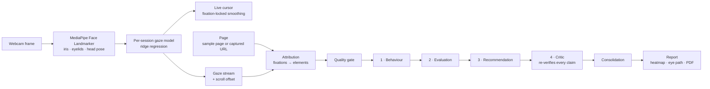

<div align="center">

# 👁️ GazeLens

**See what your users actually see.**

Webcam eye tracking and AI-agent UX reports, no special hardware needed.
Built on **GazeUX-Agent**, a multi-agent framework for gaze-driven UI/UX evaluation.


-8A63D2)


</div>

---

## Contents

- [What GazeLens does](#what-gazelens-does)
- [Screenshots](#screenshots)
- [How it works](#how-it-works)
- [Measured results](#measured-results)
- [Tech stack](#tech-stack)
- [Repository layout](#repository-layout)
- [Getting started](#getting-started)
- [Configuration](#configuration)
- [Using GazeLens](#using-gazelens)
- [API overview](#api-overview)
- [Testing](#testing)
- [Developer tools](#developer-tools)
- [Limitations](#limitations)
- [Roadmap](#roadmap)
- [Team and contributing](#team-and-contributing)

---

## What GazeLens does

Lab eye trackers are expensive, and even with gaze data someone still has to work
out *why* a design failed. GazeLens does both jobs with an ordinary laptop webcam:

1. **Calibrate in about a minute.** The user follows 16 dots, then a 5-dot accuracy
   check measures how far off the tracking is. A setup that's too inaccurate is
   refused rather than trusted.
2. **Test any page.** Pick one of five built-in sample pages, or paste a link to any
   website. GazeLens screenshots the page and finds its buttons, links, images and
   forms automatically.
3. **Use it normally.** A live gaze cursor follows the user's eyes while they browse.
   Long pages scroll, and the scroll position is recorded with every frame.
4. **Get a report.** Gaze is matched to page elements, then four agents analyse it.
   The report has a verdict, a heatmap, an eye path, per-element charts, what to fix
   and how, and a downloadable PDF.

Every finding cites a measured number (for example *"Received only 0.0% of total gaze
time (threshold: 5.0%)"*). A dedicated critic agent re-derives each claim from the raw
metrics and throws out anything it can't confirm.

### Key features

| | |
|---|---|
| 🎯 **Webcam gaze tracking** | MediaPipe iris + eyelid + head-pose features, per-session ridge model, 16-point calibration and a 5-dot accuracy check |
| 🧭 **Steady live cursor** | Fixation-locked smoothing holds still while the eyes rest and follows real eye movements within ~0.3 s |
| 🌐 **Any website** | Playwright captures the full page and detects elements; gaze is mapped through scrolling to the whole document |
| 📊 **Per-element metrics** | Dwell time, time to first look, fixation count, revisits and scanpath for every element |
| 🤖 **Four-agent analysis** | Behaviour → Evaluation → Recommendation → Critic, with optional LLM writing (Groq or Claude) that the critic must verify |
| 🛡️ **Honest by design** | A quality gate blocks findings when tracking is unreliable, and elements smaller than the measured error are flagged as indicative |
| 🔥 **Report visuals** | Heatmap over the real page (blur = measured error), an eye path built from real fixations, attention bars and a first-look timeline |
| 📄 **PDF reports** | Branded, print-ready PDF with the verdict, visuals, problems, fixes and a "how we checked" audit |
| 📈 **Analytics across tests** | Problems per test, urgency breakdown, recurring design principles, key-element coverage and accuracy trend |
| 🔐 **Accounts** | Sign-up and sign-in (bcrypt + JWT); every session and report is scoped to its owner |

---

## Screenshots

| Session report | Heatmap over the real page |
|---|---|
|  |  |
| **Eye path (real fixations, grouped into areas)** | **Downloadable PDF report** |
|  |  |
| **AI insights: the four agents and their findings** | **Analytics across every test** |
|  |  |
| **Choosing what to test** | **Landing page: who it's for** |
|  |  |

---

## How it works



**1. Calibration** (`backend/calibration`, `backend/gaze_estimation`).
The user looks at 16 dots in random order, about 24 frames each. Several feature sets
are compared: iris position relative to the eye corners, eyelid openness, MediaPipe
`eyeLook*` blendshapes and head pose. Model degree and ridge strength are chosen by
leave-one-point-out cross-validation. Degree-1 models are fitted on one median row
per dot, which removes the frame noise that otherwise squashes gaze towards the
screen's centre. A 5-dot accuracy check then measures the error on *new* points.
A per-axis bias correction is kept only if it beats the raw model by 10% on held-out
dots, and calibrations over 15% of the screen diagonal are refused.

**2. Live session** (`backend/api`, `frontend-new/src/views/LiveSession.jsx`).
Each webcam frame goes to the server, which returns a gaze point remapped into the
page area. The cursor uses a fixation-locked stabiliser
(`frontend-new/src/lib/gazeStabilizer.js`). The server stores the raw stream, because
fixation detection needs real saccade timing.

**3. Any URL** (`backend/render`).
Playwright captures a full-page screenshot and detects interactive and content
elements with heuristic classification. Every capture reports how much was guessed.
Gaze points carry the page's scroll offset and are translated into document
coordinates, so long pages work.

**4. Attribution** (`backend/attribution`).
Dispersion-based fixation detection, then hit-testing against element boxes with a
near-miss tolerance tied to the measured tracking error. This produces dwell time,
time to first fixation, fixation and revisit counts, and the scanpath.

**5. Agents** (`backend/agents`).

| Agent | Role | With an LLM key |
|---|---|---|
| Quality gate | Blocks findings when gaze error, tracking coverage or data volume is too poor ("insufficient"), or caps severity ("limited") | unchanged |
| 1 · Behaviour | First noticed, most attended, ignored important elements, scattered attention | also writes a plain-English account of the session |
| 2 · Evaluation | Maps behaviour to usability heuristics with a severity | also explains each issue for this specific page |
| 3 · Recommendation | Template fixes per issue | writes one specific fix per issue, naming the element |
| 4 · Critic | Re-derives every cited metric and every number in the text; rejects what it can't confirm | **always deterministic, never calls an LLM** |
| Consolidation | One issue and one fix per element, readable names, caveats on elements smaller than the gaze error | unchanged |

**6. Reports** (`backend/reports`).
The heatmap is gaze density over the page screenshot, blurred by the measured error
and with the hottest spots numbered. The eye path groups real fixations into areas,
sized by time and numbered by first visit. The HTML report renders to PDF through
WeasyPrint, or headless Chromium as a fallback.

---

## Measured results

All numbers below are reproducible from data and scripts in this repository.

### Gaze accuracy (webcam, held-out accuracy-check dots)

Measured with `scripts/evaluate_gaze_sessions.py`, which retrains each saved
calibration and scores it on that sitting's 5 accuracy-check dots. These dots are
never used for training.

| Model | Median error | p90 error | Vertical gain* |
|---|---|---|---|
| Fitted on every frame (previous) | 76 px | 137 px | 0.65 |
| **Fitted on per-dot medians (current)** | **65 px** | **120 px** | **0.83** |

\*Gain is the slope of predicted vs. true position; 1.0 means the full screen range
is reproduced. Basis: 4 calibrations, 20 check dots, one participant, on a
1694×840 laptop screen. A multi-participant study is still to come (see
[Limitations](#limitations)).

### Live cursor stability

Replaying recorded accuracy-check frames through each smoothing method:

| Method | Average movement while holding still | Worst 5% | Frames to follow a real move |
|---|---|---|---|
| Raw | 118 px | 260 px | 0 |
| One-Euro filter (previous) | 44 px | 97 px | 2 |
| **Fixation-locked stabiliser (current)** | **14 px** | **38 px** | **3 (~0.3 s)** |

### Pupil detector benchmark (research component)

Three detectors were trained and compared on the LPW dataset. **The live pipeline
uses MediaPipe iris landmarks instead.** On a ~30 px webcam eye crop the
LPW-trained detector was out of domain, and the first real calibration with it
had no usable signal (437 px median error). The detector stays available for the
iris-vs-detector ablation (`FIXATION_PUPIL_SOURCE=fused|yolo`).

| Model | Precision | Recall | mAP@0.5 | FPS |
|---|---|---|---|---|
| YOLOv8n (retrained, held-out) | 0.925 | 0.683 | 0.746 | 18.95† |
| Faster R-CNN | 0.926 | 0.938 | 0.954 | 23.3 |
| SSD300 | 0.991 | 0.869 | 0.975 | 127.1 |

†CPU at batch size 1; the other two FPS figures are GPU, so not directly
comparable. The Faster R-CNN and SSD rows are not yet re-run on the held-out
subject split.

<details>
<summary>YOLOv8n recall by condition (where webcam conditions hurt)</summary>

| Condition | Images | Precision | Recall | F1 | mAP@0.5 |
|---|---|---|---|---|---|
| All | 29,999 | 0.925 | 0.683 | 0.785 | 0.746 |
| Indoor | 20,000 | 0.958 | 0.810 | 0.878 | 0.843 |
| Outdoor | 9,999 | 0.817 | 0.427 | 0.561 | 0.538 |
| Natural light | 25,999 | 0.930 | 0.660 | 0.772 | 0.735 |
| Artificial light | 10,000 | 0.950 | 0.719 | 0.819 | 0.734 |
| No glasses | 23,999 | 0.939 | 0.784 | 0.854 | 0.846 |
| Glasses | 6,000 | 0.793 | 0.278 | 0.412 | 0.329 |

Precision stays high everywhere; recall drops most with glasses (0.784 → 0.278).
</details>

---

## Tech stack

| Layer | Technology |
|---|---|
| Frontend | React 18, Vite 5, Tailwind CSS 3, Framer Motion |
| API | FastAPI, Pydantic, SQLAlchemy + SQLite, bcrypt + JWT |
| Computer vision | MediaPipe Face Landmarker (iris, blendshapes, head pose), OpenCV |
| Gaze model | NumPy ridge regression with LOPO model selection |
| Page capture | Playwright (headless Chromium) |
| Reports | Jinja2, Matplotlib, WeasyPrint / Chromium PDF |
| Agents | Rule engine + optional LLM (Groq `openai/gpt-oss-120b` or Anthropic Claude) |
| Detector research | Ultralytics YOLOv8, torchvision SSD300 / Faster R-CNN |

---

## Repository layout

```
gazelens/
├── backend/
│   ├── api/              FastAPI app: auth, sessions, live gaze, reports (CONTRACT.md)
│   ├── calibration/      16-point capture, per-point quality, storage (CONTRACT.md)
│   ├── cv/               MediaPipe landmarking, iris pupil, optional YOLO fusion
│   ├── gaze_estimation/  feature sets, ridge model, LOPO selection, accuracy check,
│   │                     bias correction, offline evaluation (CONTRACT.md)
│   ├── attribution/      fixations → per-element metrics (CONTRACT.md)
│   ├── render/           URL capture + element detection (CONTRACT.md)
│   ├── agents/           quality gate, 4 agents, consolidation, LLM client
│   └── reports/          heatmap, eye path, HTML/PDF report template
├── frontend-new/         the web app (landing, auth, calibration, live test,
│                         sessions, report, gaze map, analytics, AI insights, reports)
├── test_uis/             5 sample pages with element configs
│                         (shop product, sign-up form, dashboard, login, article)
├── scripts/              model asset fetchers, gaze evaluation, API client generator
├── evaluation/, training/, configs/   detector training and benchmark
├── docs/screenshots/     images used in this README
├── frontend/             earlier prototype UI (superseded by frontend-new)
└── OPEN_ITEMS.md         open research items with concrete next steps
```

---

## Getting started

### Requirements

- **Python 3.12** (pinned in `.python-version`). MediaPipe has no wheels for
  3.13+, and without it there is no live gaze.
- **Node.js 18+** and npm.
- A webcam. A GPU is only needed to *retrain* the detectors.

### 1. Backend

```bash
git clone https://github.com/goyalnishtha841/gazelens.git
cd gazelens

python3.12 -m venv .venv
source .venv/bin/activate                 # Windows: .venv\Scripts\activate

# CPU-only torch keeps the install small
pip install --index-url https://download.pytorch.org/whl/cpu torch torchvision
pip install -r requirements.txt

python scripts/fetch_face_landmarker.py   # models/face_landmarker.task (needed for live gaze)
playwright install chromium               # URL capture + PDF rendering

cd backend
python -m api.init_db --demo-user         # creates demo@example.com / demo-password-123
uvicorn api.main:app --reload --port 8000
```

Run the API from `backend/` as `uvicorn api.main:app`, not from inside `backend/api`.
Several packages define a `schemas.py`, and running from inside would shadow them.
`GET http://localhost:8000/health` reports whether live capture is available.

### 2. Frontend

```bash
cd frontend-new
npm install
npm run dev                               # http://localhost:5180
```

The dev server proxies `/api` and `/health` to `localhost:8000`.

### 3. Try it

Open <http://localhost:5180>, sign in with `demo@example.com` / `demo-password-123`
(or create an account), complete the camera setup, and run a test.

> Use Chrome or Edge and allow camera access. Sit about an arm's length from the
> screen with even light on your face and keep your head still. The accuracy check
> tells you if a second try is needed.

---

## Configuration

All settings are optional environment variables.

| Variable | Purpose | Default |
|---|---|---|
| `FIXATION_SECRET_KEY` | JWT signing key (set this for any deployment) | generated into `backend/api/.secret_key` |
| `FIXATION_TOKEN_TTL_MINUTES` | Login session length | `720` |
| `FIXATION_DATA_DIR` | Where gaze streams, captures and reports are stored | `backend/api/session_data` |
| `GROQ_API_KEY` | Enables LLM writing via Groq (free tier) | off |
| `ANTHROPIC_API_KEY` | Enables LLM writing via Claude | off |
| `GAZELENS_LLM_PROVIDER` | `groq` or `anthropic` when both keys are set | Claude if both set |
| `GAZELENS_LLM_MODEL` | Override the provider's model | `openai/gpt-oss-120b` / `claude-opus-5-5` |
| `GAZELENS_LLM_EFFORT` | `low` / `medium` / `high` | `medium` |
| `GAZELENS_LLM` | `off` forces the rule-based agents even with a key | on when a key is set |
| `FIXATION_PUPIL_SOURCE` | `iris` (default), `fused` or `yolo`, for the detector ablation | `iris` |
| `FIXATION_PUPIL_WEIGHTS` | Path to custom detector weights | `models/pupil_yolo_final.pt` |

**LLM mode.** Both clients are in `requirements.txt`; set a key and restart the API. Agents 1–3 then write their text with the LLM, and each
piece of text includes structured claims. The critic recomputes every claim and every
measurement-like number in the prose; one number it can't re-derive rejects that text,
and the rule-based output is used instead. API errors and malformed replies also fall
back to the rules. Each report records the mode, provider, model and an audit of
rejections (`pipeline_result["llm"]`), shown under *How we checked* in the PDF.

---

## Using GazeLens

| Page | What it's for |
|---|---|
| **Home** | Calibration status, recent report, quick actions |
| **New test** | Choose a sample page (live previews) or load your own website |
| **Calibration** | 16 dots + 5-dot accuracy check, with plain-language results |
| **Live recording** | The page with the live gaze cursor, a camera preview and notes |
| **Report** | Verdict, accuracy ring, heatmap / eye path, attention and first-look charts, problems, fixes, reliability, PDF download |
| **Sessions** | Every test, its status and number of problems |
| **Gaze Map** | Heatmap, eye path and per-element charts for any finished test |
| **Analytics** | Trends across all tests |
| **AI Insights** | The agent pipeline with live counts, and every finding with its fix |
| **Reports** | Gallery of reports with heatmap previews and PDF downloads |
| **System status** | Server, face detection and calibration health |

---

## API overview

Interactive docs at <http://localhost:8000/docs> once the API is running.

| Endpoint | Description |
|---|---|
| `POST /api/auth/signup`, `POST /api/auth/login`, `GET /api/auth/me` | Accounts |
| `POST /api/calibration/sessions`, `…/{id}/samples`, `…/{id}/complete` | Calibration capture |
| `POST /api/gaze/models/{id}/train`, `…/validate`, `…/estimate` | Train, accuracy check, estimate |
| `POST /api/render/capture` | Screenshot a URL and detect its elements |
| `GET /api/sessions/meta/test-uis` | List the sample pages |
| `POST /api/sessions` | Create a test (sample page or URL) |
| `POST /api/sessions/{id}/calibration` | Link a calibration and train the gaze model |
| `POST /api/sessions/{id}/gaze/frame` | One webcam frame → one gaze point (with scroll offset) |
| `POST /api/sessions/{id}/finalize` | Run attribution, agents and report rendering |
| `GET /api/sessions/{id}/report`, `/heatmap`, `/scanpath`, `/pdf` | Report data and files |
| `GET /api/sessions`, `DELETE /api/sessions/{id}` | List and delete tests |
| `GET /health` | Service and model status |

Each backend module documents its own contract in its `CONTRACT.md`.

---

## Testing

The backend has **707 tests** across 8 suites. None needs a webcam, model weights or
an API key: the detector is stubbed, gaze models train on synthetic sessions and the
LLM is faked. Each suite runs from its own folder:

```bash
cd backend/agents          && python test_agents.py           #  89  agents, gate, consolidation
cd backend/agents          && python test_llm_agents.py       #  37  LLM mode + critic rejections
cd backend/api             && python test_api.py              # 141  full session lifecycle
cd backend/attribution     && python test_attribution.py      #  95  fixations → metrics
cd backend/calibration     && python test_calibration.py      #  76  capture + quality
cd backend/cv              && python test_cv.py               #  73  landmarks + pupil
cd backend/gaze_estimation && python test_gaze_estimation.py  # 141  models, selection, accuracy check
cd backend/render          && python test_render.py           #  55  URL capture (local fixture)
```

---

## Developer tools

```bash
# Compare gaze model variants on every saved calibration's accuracy-check dots
python scripts/evaluate_gaze_sessions.py

# Re-render existing reports after changing the visuals or the PDF template
cd backend && python -m api.rerender_reports

# Run the agent chain on mock sessions (uses an LLM if a key is set)
cd backend/agents && python orchestrator.py

# Try live landmark + pupil detection against your webcam
cd backend/cv && python webcam_demo.py

# Detector benchmark
python evaluation/evaluate.py --model frcnn --weights runs/frcnn/frcnn_final.pth
python evaluation/evaluate.py --model ssd   --weights runs/ssd/ssd_final.pth
yolo val model=models/pupil_yolo_final.pt data=configs/lpw.yaml
python evaluation/compare_models.py
```

Model weights and datasets are kept out of git:

| Asset | How to get it |
|---|---|
| `models/face_landmarker.task` | `python scripts/fetch_face_landmarker.py` (required for live gaze) |
| `models/pupil_yolo_final.pt` | Team Drive (only for the detector ablation and benchmark) |
| `models/pupil_smoketest.pt` | `python scripts/make_smoketest_detector.py`, a stand-in for tests (never report numbers from it) |

---

## Limitations

- **Accuracy is webcam-grade.** ~65 px median error is enough to tell which button,
  image or heading someone looked at, not which word. Findings on elements smaller
  than the measured error are marked as indicative.
- **The accuracy figures come from one participant.** A multi-participant pilot study
  is the next step; see [OPEN_ITEMS.md](OPEN_ITEMS.md).
- **Head movement after calibration lowers accuracy.** The app warns when you've
  moved, and recalibrating fixes it.
- **Captured websites are static snapshots**, and their element types are inferred
  from the DOM rather than designed. Reports say how much was guessed.
- **Not yet deployed.** It runs locally; webcam access needs HTTPS in production.

---

## Roadmap

- [x] Webcam gaze pipeline with calibration, accuracy check and quality gate
- [x] Gaze-to-element attribution and metrics
- [x] Four-agent analysis with a deterministic critic
- [x] Optional LLM writing (Groq / Claude) verified by the critic
- [x] Arbitrary-URL testing with full-page scrolling
- [x] Heatmap, eye path and branded PDF reports
- [x] Web app: landing, sessions, report, gaze map, analytics, AI insights
- [ ] Multi-participant pilot study and results
- [ ] Multi-participant studies in the app (aggregate several people on one page)
- [ ] Deployment (HTTPS hosting), Docker and CI
- [ ] Head-movement compensation during sessions
- [ ] Password reset, account settings and "delete my data"

---

## Team and contributing

GazeLens is a capstone project by a five-member team.

<!-- Team: add each member's name, role and GitHub profile below. -->

| Member | Area |
|---|---|
| Nishtha Goyal | |
| Eva Singh | |
| arshia080 | |
| | |
| | |

**Contributing:** create a branch (`git checkout -b <name>/<feature>`), keep the
module's tests passing, and open a pull request into `main`.

**Research target:** ETTAC 2026 (Eye Tracking Techniques, Applications and
Challenges), held with ICPR 2026.

**License:** not yet chosen. All rights reserved by the authors until one is added.
